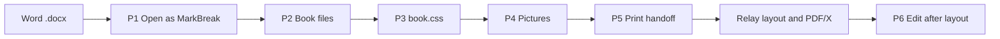

# MarkBreak writing-to-print phases

How a book goes from an opened `.docx`, through writing and styling in MarkBreak, to a print handoff. The findings ledger stays in [PICTURE_BOOK_PLAN.md](PICTURE_BOOK_PLAN.md); update that file when a phase closes.

At the end of each phase: tick it here, mark matching F/W/D items in `PICTURE_BOOK_PLAN.md` as Landed with commit ids, and for dialect or RigWorks changes commit where they live then bump the pin.

---

## Phase 0 - Ground

**Goal:** A fixture book that exports cleanly, and a clean starting point for the writer work.

**Items**

- Leave uncommitted locale, menu and `site/` changes alone; they are not this work.
- Fixture at `packages/desktop/test/fixtures/picture-book/`:
  - a small MarkBreak manuscript with `meta.md`, `layout.rig.json`, scene breaks and two images;
  - the same book as a Word `.docx` (saved from export or a hand-authored fixture);
  - fixture art from an in-repo script (no third-party illustrations).

**Gate:** the fixture exports through `writeWithProfile` (`packages/desktop/src/main/utils/markbreakExport.ts`) with no errors.

**Plan items closed:** none yet (ground only).

- [x] Done — fixture at `packages/desktop/test/fixtures/picture-book/`

---

## Phase 1 - Open a Word file as MarkBreak (mammoth.js)

**Goal:** File → Import (or drop) a `.docx` becomes a MarkBreak manuscript with breaks, headings and images intact.

**Items**

- New `packages/desktop/src/main/utils/docxImport.ts`, routed from `openPandocFile` in `packages/desktop/src/main/menu/actions/file.ts` for `.docx` only; other formats keep pandoc.
- XML pre-pass on `word/document.xml` turns breaks into sentinel paragraphs before mammoth reads the file:
  - `w:br w:type="column"` → `//break`
  - `w:type="page"` → `//break page`
  - `w:sectPr` `w:type` `oddPage` / `evenPage` → `//break odd` / `even`
  - Exact inverse of `markbreak.lua` lines 39–47.
- mammoth.js produces HTML with a style map for Title, Heading 1–4, Quote, lists and the sentinel paragraphs.
- Images go to `<name>-images/` through `convertImage`, keeping original file names where Word kept them.
- HTML → Markdown via Muya's `htmlToMarkdown` (export it from `@muyajs/core` if needed).
- Import writes `<name>.md` beside the `.docx` (ask before overwrite), then opens it.
- mammoth warnings appear as one notification.
- Dialect (13-Books/markbreak): Word writer stamps role as `custom-style` (e.g. "Role chapter"); import maps it back to front matter `role:`. Bump `dialect/markbreak` pin and `dialect/CONFORMANCE.md`.

**Gate (unit specs in `packages/desktop/test/unit`):**

- Fixture `.md` exports to Word and imports again with the same headings, breaks and images.
- The Word-saved fixture imports with its breaks.
- `pnpm run validateLicenses` passes (mammoth is BSD-2).

**Plan items closed:** F40 (writer side); markbreak-app twin of W5.4.

- [x] Done — `docxImport.ts`, break pre-pass, mammoth, role custom-style in `markbreak.lua`

---

## Phase 2 - Book files from Word and in the writer

**Goal:** Import recovers page geometry and imprint; the writer can edit front matter.

**Items**

- From the `.docx`:
  - `layout.rig.json` from `w:sectPr` `pgSz` / `pgMar` / `mirrorMargins` → `rig.layout.page` in mm plus `rig.layout.facing` (inverse of `updateSectionXml` in `dialect/export.sh`).
  - `meta.md` from `docProps/core.xml` (title, author, language).
  - Front matter links both files.
- Front matter panel for `role`, `meta`, `layout` and `spine`, with the closed role list from the specification §3.1.
- Pages and Spreads read trim and margins from the linked layout (`readBookPage`).

**Gate:** import the fixture, export to Word; page size and margins match the source `.docx`.

**Plan items closed:** W5.2 (writer side of layout/meta).

- [x] Done — layout/meta from docx; Book sidebar panel for role / meta / layout / stylesheet

---

## Phase 3 - Style the book with `book.css`

**Goal:** One sheet beside the manuscript drives Pages/Spreads preview and travels with the handoff. Mapping: RigWorks 1.6.0 [`docs/css.md`](../RigKit/docs/contract/RigWorks/docs/css.md).

**Items**

- Sheet lives as `book.css` beside the root manuscript. A `stylesheet:` front-matter key waits on a MarkBreak spec change (D4).
- Preview applies the sheet natively (`pagesView.vue`, `util/pageLayout.ts`); each role flow wraps in `data-role` so `[data-role=chapter] p` works as `css.md` specifies.
- Lint lists every selector, declaration or value outside the `css.md` mapping.
- HTML export embeds the sheet; Phase 5 carries `book.css` unchanged.

**Gate:** fixture sheet styles the preview; lint reports one deliberately unmapped property.

**Plan items closed:** W3 (markbreak-app side), D4 (convention until spec).

- [x] Done — `book.css` in Pages/Spreads, `data-role`, `cssLint.ts`

---

## Phase 4 - Pictures in the manuscript

**Goal:** Illustration paths and sizes survive the Word round trip; the author sees print-size warnings.

**Items**

- Image attributes `{width=... .class}` survive export (W5.3).
- Original art path rides in the Word alt / `descr` text (D5) so Relay links the original, not the docx copy.
- Preview shows each image at print size; warn when effective ppi at trim is under 300 (W1.5, writer side).

**Gate:** fixture's two images keep their original paths through export and import.

**Plan items closed:** W5.3 (writer), D5, W1.5 (writer).

- [x] Done — `original:` image titles in filter; import re-links; `imagePpi.ts` + Book panel warnings

---

## Phase 5 - Print handoff

**Goal:** One action sends the book to Relay ready for layout and PDF/X.

**Items**

- Print-proof PDF from Pages/Spreads (geometry + sheet). Proof only, not press PDF.
- "Open in Relay" (W5.6): write MarkBreak `.docx`, `layout.rig.json`, `meta.md`, `book.css` and the art folder side by side, then run Relay `--open`. Relay owns W5.1 / W5.2 on its side.
- Preview marks scene boundaries and shows page count; warn when count is not a multiple of 4.

**Gate:** fixture opens in Relay with breaks, roles, page size and sheet.

**Plan items closed:** W5.6; W5.1/W5.2 (handoff contract).

- [x] Done — `relayHandoff.ts`, Book panel "Open in Relay", page-count badge

---

## Phase 6 - Edit after layout

**Goal:** Author edits text in MarkBreak after layout without losing placed art.

**Items**

- Relay owns update-from-source (W5.5).
- markbreak-app: re-export to the same handoff folder in place; show "sent to Relay" state.

**Gate:** one changed paragraph reaches Relay with no art moved.

**Plan items closed:** W5.5 (writer side).

- [x] Done — Book panel "Update Relay" re-exports into the handoff folder
